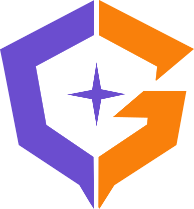

<p align="center">
  <a href="https://gankerweb.app/">
    
  </a>
</p>

<h1 align="center">Ganker</h1>

<p align="center">
  <strong>Encuentra. Conecta. Compite.</strong><br>
  Una plataforma para encontrar jugadores, formar equipos y compartir partidas.
</p>

<p align="center">
  <a href="https://gankerweb.app/">
    
  </a>
</p>

<p align="center">
  <a href="https://gankerweb.app/">Abrir la aplicación</a> ·
  <a href="backend/README.md">Guía del backend</a> ·
  <a href="Frontend/README.md">Guía del frontend</a>
</p>

## Tecnologías

| Área          | Tecnologías                                                                         |
| ------------- | ----------------------------------------------------------------------------------- |
| Backend       | Python, FastAPI, Uvicorn, Pydantic, SQLAlchemy y Alembic                            |
| Frontend      | React, Vite, React Router, Axios, React Hook Form y Tailwind CSS                    |
| Base de datos | SQLite para desarrollo local; PostgreSQL 16 en Docker                               |
| Comunicación  | API REST y WebSockets para chat, notificaciones y actualizaciones de equipos        |
| Integraciones | Riot Games, Discord e inicio de sesión federado con Google, Discord, Twitch y Steam |
| Pruebas       | Pytest, Vitest y React Testing Library                                              |
| Despliegue    | Docker Compose, Nginx y GitHub Actions para OCI (Oracle Cloud Infrastructure)       |

Las dependencias se declaran en [backend/requirements.txt](backend/requirements.txt) y [Frontend/package.json](Frontend/package.json).

## Documentación

| Guía                           | Contenido                                                                                   |
| ------------------------------ | ------------------------------------------------------------------------------------------- |
| [Backend](backend/README.md)   | Entorno Python, secretos, base de datos, migraciones, arquitectura, convenciones y pruebas  |
| [Frontend](Frontend/README.md) | Entorno Node, conexión con la API, componentes, convenciones, pruebas y build               |
| Este README                    | Vista general, estructura del repositorio, arranque conjunto, despliegue y flujo de trabajo |

## Estructura del repositorio

```text
Ganker/
├── .github/workflows/          # CI de pruebas/build y CD hacia OCI
├── backend/                   # API, dominio, casos de uso y adaptadores
│   ├── app/                   # Código Python por capas
│   ├── media/                 # Recursos multimedia del backend
│   ├── migrations/            # Migraciones Alembic
│   ├── tests/                 # Pruebas unitarias y de integración
│   └── README.md              # Guía específica del backend
├── Frontend/                  # Aplicación React (respetar la F mayúscula)
│   ├── Public/                # Recursos estáticos (respetar la P mayúscula)
│   ├── src/                   # Código y pruebas del cliente web
│   └── README.md              # Guía específica del frontend
├── media/                     # Recursos multimedia también presentes en la raíz
├── nginx/                     # Proxy de desarrollo y servidor de producción
├── scripts/                   # Despliegue, configuración, comprobaciones y backups
├── docker-compose.yml         # Stack de desarrollo
├── docker-compose.prod.yml    # Stack de producción
├── .env.prod.example          # Plantilla de configuración de producción
├── start_all.sh / .ps1 / .bat  # Lanzadores conjuntos para entornos ya preparados
└── README.md
```

Los árboles detallados y las reglas de nombrado están en las guías de [backend](backend/README.md#estructura-y-organización) y [frontend](Frontend/README.md#estructura-y-organización).

## Desarrollo conjunto

Para ejecutar cada servicio localmente, seguí la instalación, configuración y verificación de su guía: [backend](backend/README.md#desarrollo-local) y [frontend](Frontend/README.md#desarrollo-local).

Para levantar el stack con Docker, necesitás Docker con Compose y la [configuración local del backend](backend/README.md#configuración-local) preparada. Desde la raíz del repositorio:

```bash
docker compose up --build
```

Compose levanta PostgreSQL, FastAPI, Vite y Nginx. El frontend recibe su URL de API desde Compose; el backend aplica las migraciones al iniciar el contenedor.

| Servicio                     | Acceso en desarrollo con Docker |
| ---------------------------- | ------------------------------- |
| Aplicación a través de Nginx | http://localhost                |
| API y Swagger                | http://localhost:8000/docs      |
| PostgreSQL desde el host     | `localhost:5433`                |

## Despliegue

La aplicación publicada está en **[gankerweb.app](https://gankerweb.app/)**. [docker-compose.prod.yml](docker-compose.prod.yml) usa PostgreSQL, FastAPI y Nginx en OCI; Nginx sirve el frontend compilado, la API, los WebSockets y los archivos multimedia.

La configuración compartida de producción se prepara a partir de [.env.prod.example](.env.prod.example), creando `.env.prod` en la raíz y completando los valores del entorno. Este archivo y los certificados quedan fuera de Git. Los detalles de las variables de cada aplicación están en sus guías.

La red interna usa `GANKER_INTERNAL_SUBNET` (por defecto `172.30.0.0/24`) y una IP fija para Nginx, `GANKER_NGINX_IP` (`172.30.0.10`). Uvicorn solo acepta información de proxy desde esa IP. Si la subred está ocupada, ajustá ambos valores en `.env.prod`. No es obligatorio agregar estas variables a un entorno existente si sirven sus valores por defecto.

El deploy comprueba los alias DNS de `db`, `backend` y `nginx`. Si Compose perdió alguno al recrear la red, fuerza una recreación de los contenedores conservando los volúmenes; también permite un único reintento si sucede durante el mismo despliegue. Puede producir una breve interrupción mientras reinicia PostgreSQL. El backend tiene un healthcheck HTTP que consulta `/api/v1/health`, incluida la base de datos, y Nginx espera a que esté listo. Así `up --wait` no da por válido un backend que solo alcanzó a iniciar el proceso de Alembic.

Si la red existente tiene una subred incompatible y Compose no puede reemplazarla, se puede recrear manualmente con `docker compose --env-file .env.prod -f docker-compose.prod.yml down` y luego `docker compose --env-file .env.prod -f docker-compose.prod.yml up -d --build`, conservando los volúmenes (sin `--volumes`).

El script [scripts/deploy.sh](scripts/deploy.sh) documenta los requisitos de SSH, configuración y certificados en el servidor. Para consultar sus modos desde la raíz:

```bash
bash scripts/deploy.sh --help
```

Los workflows de GitHub Actions ejecutan [pruebas y build](.github/workflows/ci.yml); el [despliegue a OCI](.github/workflows/deploy.yml) se activa tras un CI exitoso de `main` o de forma manual.

Los pushes a `main` omiten el CI y, por lo tanto, el deploy automático cuando todos los archivos modificados corresponden a estas rutas:

- Documentación Markdown (`**/*.md`).
- Archivos `.gitignore` y `.github/CODEOWNERS`.
- Lanzadores locales de la raíz: `start_all.sh`, `start_all.ps1`, `start_all.bat` y `start_frontend.sh`.
- Lanzadores del backend: `backend/start_app.sh`, `backend/start_app.ps1` y `backend/start_app.bat`.

Si el push incluye cualquier otro archivo, se ejecuta el flujo habitual. Los PR conservan sus verificaciones y el despliegue manual sigue disponible. Los cambios en los propios workflows también ejecutan el flujo habitual.

## Flujo de trabajo

1. Actualizá `main` antes de empezar una tarea: `git switch main` y `git pull origin main`.
2. Creá una rama descriptiva, por ejemplo: `git switch -c feature/busqueda-equipos`.
3. Trabajá y hacé los commits en esa rama.
4. Ejecutá las comprobaciones del área modificada y abrí un PR contra `main`, explicando el cambio y cómo verificarlo.
5. Solicitá revisión a [@Aguperez444](https://github.com/Aguperez444) para backend o a [@franleal](https://github.com/franleal) para frontend.
6. Una vez aprobado e integrado el PR, eliminá la rama de trabajo.
